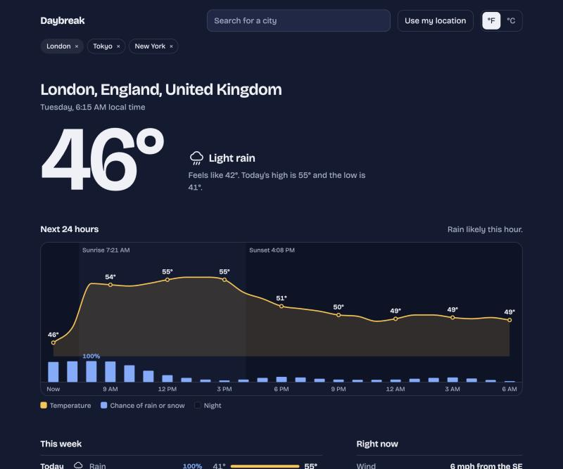

# Daybreak, a weather dashboard

[](https://github.com/eajala08/weather-dashboard/actions/workflows/tests.yml)

Search any city and see the weather now, the next 24 hours on one chart, and
the week ahead. The page changes from a daytime palette to a night one based
on whether the sun is up in the city you are looking at.



## What it does

- **City search with suggestions** as you type, usable with the keyboard alone
- **A 24-hour chart** with the temperature curve, the chance of rain for each
  hour, and shaded bands for night with sunrise and sunset marked
- **A 7-day forecast** where every day's low-to-high bar sits on one shared
  scale, so warmer and colder days are easy to compare
- **°F / °C switch** that updates instantly without reloading data
- **Recent cities** remembered between visits
- **Use my location**, with coordinates rounded to about 100 m before they
  leave the browser and never saved
- Works on phones, and shows a clear message with a retry button when the
  network or the weather service fails

## Built with

Plain HTML, CSS and JavaScript. There is no framework, no chart library and
no build step. Forecasts come from [Open-Meteo](https://open-meteo.com/), a
free weather service that needs no account or API key.

## Run it

```bash
git clone https://github.com/eajala08/weather-dashboard.git
cd weather-dashboard
python3 -m http.server 5173
```

Then open http://localhost:5173. Any static file server works. Opening
`index.html` directly from the file system does not, because browsers block
JavaScript modules on `file://` pages.

## Tests

```bash
npm test
```

32 tests cover the logic that does not need a browser: unit conversion, time
formatting, reshaping the API response, the day and night bands, and the
chart math. They use Node's built-in test runner, so there is nothing to
install. GitHub Actions runs them on every push.

## Details worth a look

- **The chart is drawn by hand as SVG.** The curve uses monotone cubic
  interpolation ([`chart-math.js`](src/chart-math.js)). An ordinary smooth
  curve can bulge above a peak and suggest 62° when the forecast high is 60°.
  This method flattens the curve wherever that would happen, and a test
  checks that it never overshoots.
- **Slow responses cannot overwrite newer ones.** If you pick Tokyo and then
  London before Tokyo finishes loading, the Tokyo request is cancelled
  ([`app.js`](src/app.js)). The same applies to search suggestions.
- **Search waits for a pause in typing** before asking for suggestions, so
  typing "Chicago" sends one or two requests, not seven.
- **Times are never converted through the visitor's time zone.** The API
  returns each city's local time as text and the page reads the clock digits
  from it, so a forecast for Tokyo reads the same from New York or London.
- **Logic and drawing are separate.** [`weather.js`](src/weather.js) and
  [`chart-math.js`](src/chart-math.js) are pure functions with no access to
  the page, which is what makes them testable.

## Project layout

```
index.html        page structure
styles.css        layout and the day and night palettes
src/
  app.js          state, search, events, drawing each section
  api.js          requests to Open-Meteo
  weather.js      weather codes, units, times, reshaping API data
  chart.js        draws the hourly chart
  chart-math.js   scales and the smooth-curve math
  icons.js        weather icons as inline SVG
  storage.js      remembers units and recent cities
tests/            32 tests
```

## How it was built

I planned the features and behavior and built the app with Claude Code as a
pair programmer.

## License

MIT. Weather data by [Open-Meteo](https://open-meteo.com/) under CC BY 4.0.
